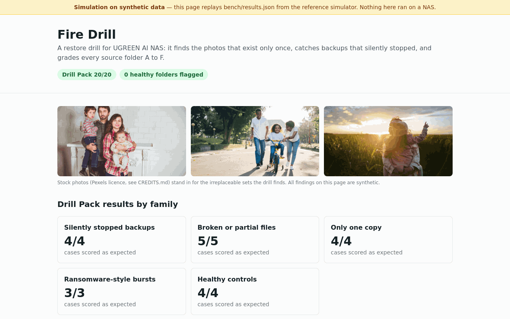
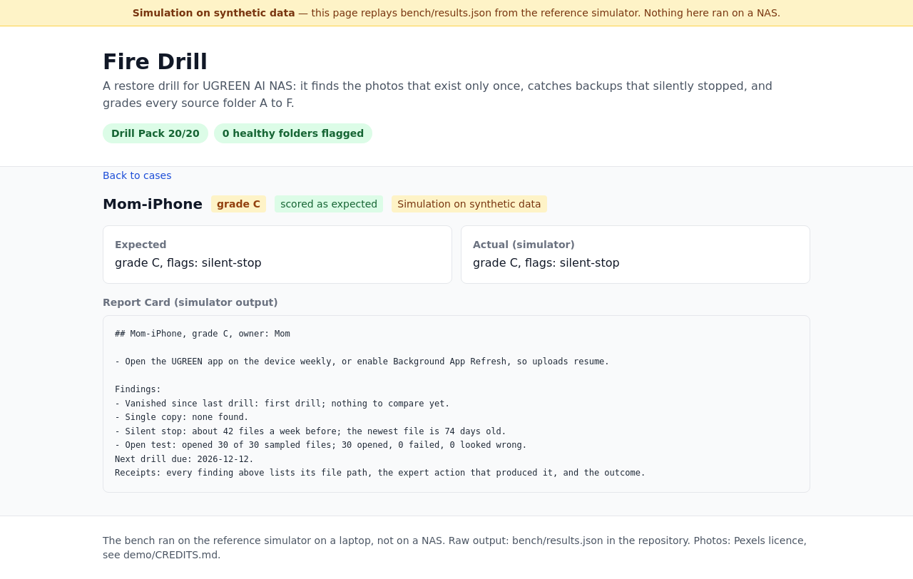
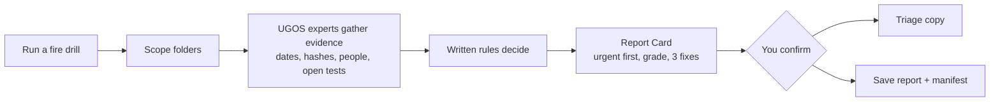
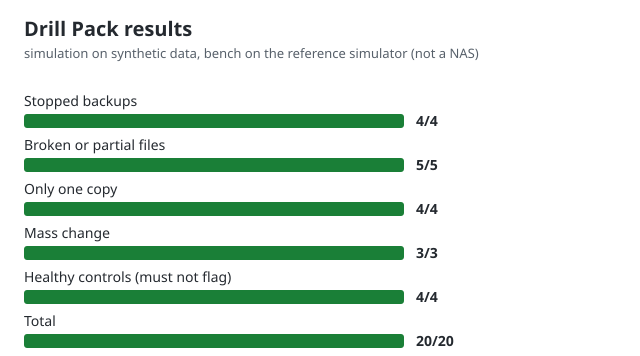

<p align="center">
  
</p>

<h1 align="center">Fire Drill</h1>

<p align="center"><b>The safety net that makes it safe to let AI touch your family photos.</b><br>
A UGOS Skill for UGREEN AI NAS that finds the photos that exist only once, copies just that set to a folder you pick, and tells you when backups silently stopped or files vanished.</p>

<p align="center">
  <a href="https://github.com/evdatsion/fire-drill/actions/workflows/ci.yml"></a>
  
  
  
  
</p>

<p align="center">
  <a href="https://evdatsion.github.io/fire-drill/"><b>Try the demo</b></a> ·
  <a href="docs/DIAGRAMS.md">Diagrams</a> ·
  <a href="docs/results.md">Results</a> ·
  <a href="docs/design.md">Design and decisions</a>
</p>

Entry for the **UGREEN Hackathon 2026 on AI NAS**, Open Innovation track.

---

## The problem

- **The NAS becomes the only copy.** People free phone space by deleting photos once they reach the NAS. RAID covers one failed disk, not theft, fire, ransomware or a failed storage pool.
- **Backups stop silently.** Phone apps stop uploading when they sit in the background, and nobody notices for months. 46% of backup users have never tested a restore ([Macrium survey, 2017](https://www.macrium.com/blog/46-of-backup-users-have-never-completed-a-test-restore-4da22c762f9d)).
- **AI agents now delete files.** On Feb 7, 2026 an AI desktop agent asked to tidy a desktop deleted about 15,000 family photos; they came back only because a second copy existed ([reported Feb 13, 2026](https://futurism.com/artificial-intelligence/claude-wife-photos)). UGOS is adding AI skills with file access.

## What a drill shows you

<p align="center">
  
</p>

| Order | Finding | What Fire Drill does about it |
|---|---|---|
| 1 | **Vanished since the last drill** | Names what is gone, where it was last seen, and the recovery routes that exist |
| 2 | **Only one copy** | Counts the irreplaceable photos (people, family events) and, after you confirm, copies just that set |
| 3 | **Silently stopped backups** | Compares the newest file against the folder's own rhythm |
| 4 | **Broken or partial uploads** | Opens a sample with on-device vision and OCR; warns on ransomware-like mass changes |
| 5 | **Grade A to F per person** | At most 3 concrete fixes, a receipt behind every finding |

Read-only except for the copy and the report you confirm. Never deletes. A folder it cannot read reports **could not check** and is never graded.

## How it works



The on-device AI opens and classifies files. **Rules decide** every flag and grade. Full set of diagrams, including the silent-stop rule, the triage-copy sequence and the vanish check: [docs/DIAGRAMS.md](docs/DIAGRAMS.md).

## Results: the Drill Pack

20 synthetic cases with an expected result each: 4 stopped backups, 5 broken files, 4 single-copy photo sets, 3 ransomware-style rename bursts and 4 healthy controls that must not be flagged.

<p align="center">
  
</p>

| Case type | Cases | Matched |
|---|---|---|
| Stopped backups | 4 | 4 |
| Broken or partial files | 5 | 5 |
| Only one copy | 4 | 4 |
| Mass change | 3 | 3 |
| Healthy controls (must not flag) | 4 | 4 |
| **Total** | **20** | **20/20** |

The bench runs on the reference simulator (`sim/`), which applies the same written rules to synthetic folders on a laptop. It has not run on a NAS yet. Raw output: [bench/results.json](bench/results.json). Reproduce: `npm run bench`.

### Holdout validation

The Drill Pack was written alongside the rules, so on its own it cannot show whether the rules generalise. Two adversarial holdout packs, written by a reviewer who did not tune the rules against them, test that:

| Pack | Score | What it is |
|---|---|---|
| Design pack | 20/20 | the 20 cases above |
| Blind pack v1 | 6/6 | 6 cases the rules had never seen (1/6 before the fixes, 6/6 after) |
| Blind pack v2 | 2/4 | 4 further cases, written after the fixes to probe them |

Blind v2's remaining misses are named in Known gaps below. Per-case output is in [bench/results.json](bench/results.json).

## At a glance

- ✅ Markdown-only Skill package, passes the official kit checker
- ✅ Every capability it uses is confirmed in the UGOS catalog, with line numbers
- ✅ Rules decide, AI assists; receipts on every finding
- ✅ Two confirmation gates: the triage copy and the saved report
- ✅ Drill Pack with 4 healthy controls
- ⚠️ Not yet run on a NAS: finalist-day work
- ⚠️ No USB listing, snapshots or scheduler in UGOS: worked around, see Known gaps

## Built with UGOS

| UGOS capability | What Fire Drill uses it for |
|---|---|
| ug-filesystem find, stat, sha256sum | Newest-file dates, arrival rhythm, copy counts |
| ug-filemgr scan-dedupe | Which photos exist only once |
| ug-photo search-picture, search-screen | People and family events vs screenshots |
| ug-photo vision-ocr, vision-vlm, meta | Open test on a sample, capture dates |
| ug-document qa, extract | Open test for documents |
| ug-filesystem cpmv | The triage copy, after you confirm |
| ug-knowledge save-text | Report Card and manifest, after you confirm |

Catalog line numbers for each: [docs/DIAGRAMS.md#8-ugos-capability-map](docs/DIAGRAMS.md#8-ugos-capability-map).

## Quickstart

```sh
git clone https://github.com/evdatsion/fire-drill.git && cd fire-drill
npm ci
npm test                 # rules, one test per rule and failure path
npm run bench            # 20-case Drill Pack on the simulator
npm run demo             # demo app on localhost
node <path-to-uliya-skill-kit>/scripts/check-skill.mjs skill/backup-fire-drill
```

The UGREEN skill kit is licensed separately and is not in this repository.

## Layout

```
skill/backup-fire-drill/   the Skill package (SKILL.md + references), zipped for submission
sim/                       reference simulator: same written rules, synthetic folders
bench/                     Drill Pack (expected.json) and latest results
demo/                      demo app, replays simulator output, labelled "simulation on synthetic data"
proposal/                  Round 1 proposal (500 words max) and figures
docs/                      design, diagrams, results, screenshots
```

## Known gaps

- It checks a sample of files, not every file; pass rates describe the sample.
- UGOS exposes no USB listing: the copy goes to a folder you pick, and Fire Drill says it cannot verify that folder is an external drive.
- No snapshot access and no recycle-bin listing: vanished files point only to recovery routes that exist (restore by path, the triage copy).
- No scheduler: drills run when asked, and every Report Card ends with "next drill due".
- Ransomware signs are warnings, not guaranteed detection. Encryption that changes files in place without renaming them can evade all three tells on a folder under 100 files (blind pack v2).
- A folder with a long natural cadence (for example a yearly holiday camera) is exempted from the stop check only when the user marks it seasonal; the rule does not yet infer that cadence from the arrival pattern alone (blind pack v2).
- Not yet run on a NAS.

## Safety and privacy

Reads files through UGOS experts on the NAS. Writes only the triage copy and the report with its manifest, each after you confirm. Never deletes, moves or edits your files. Nothing leaves the device. All test data in this repository is synthetic.

## Roadmap

- Finalist day: run the Drill Pack on a real iDX6011 Pro and publish the measured score.
- Use photo capture dates (EXIF) alongside file dates for the silent-stop rule.
- Scheduled drills once UGOS exposes a scheduler.

## License

MIT
