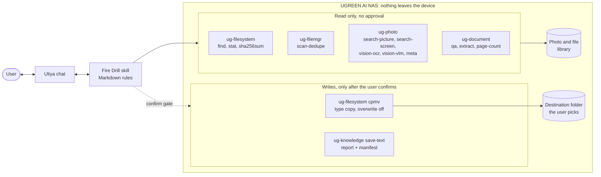
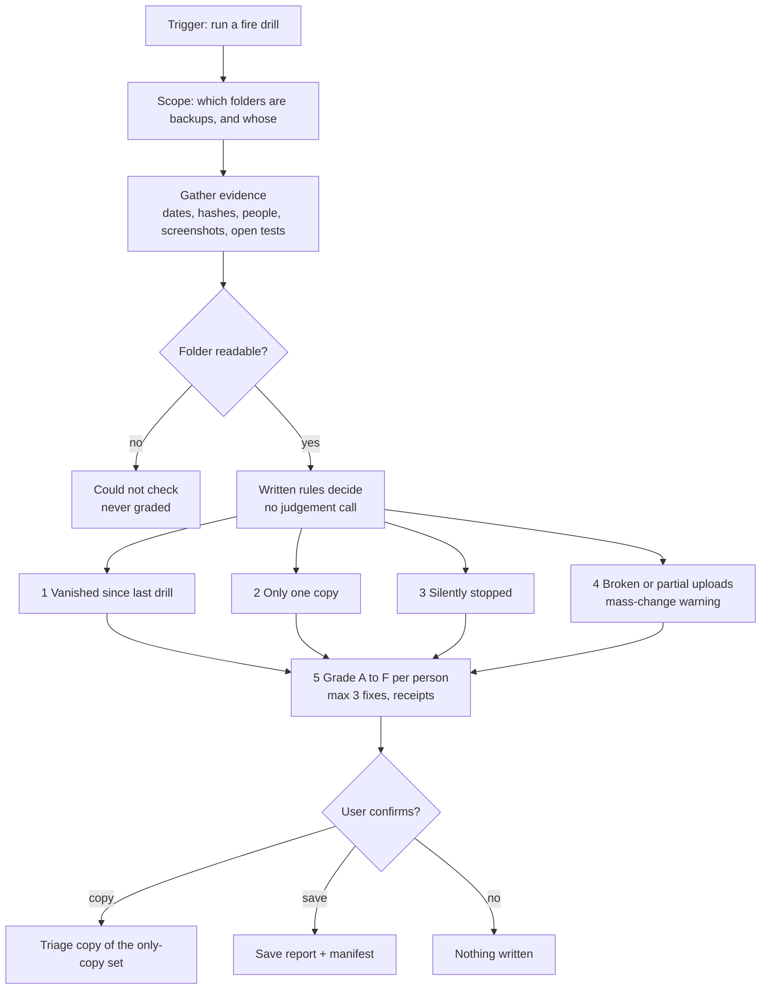
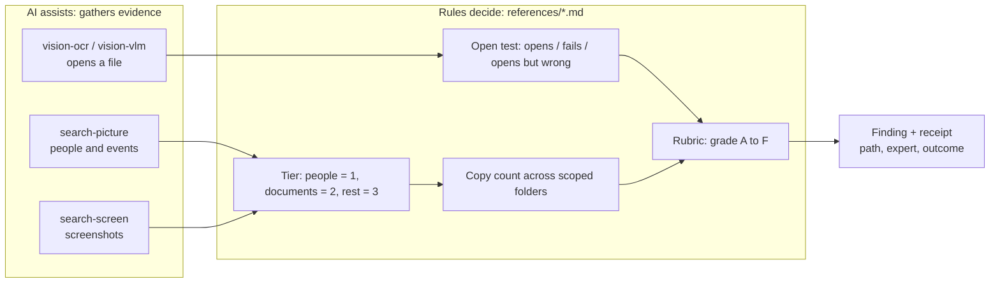
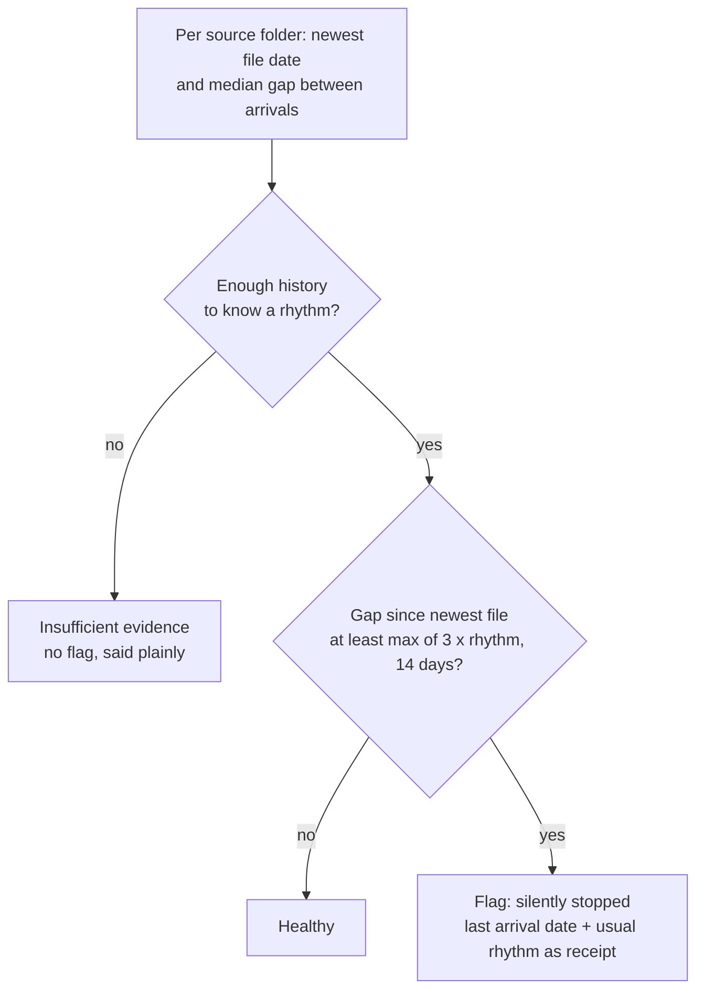
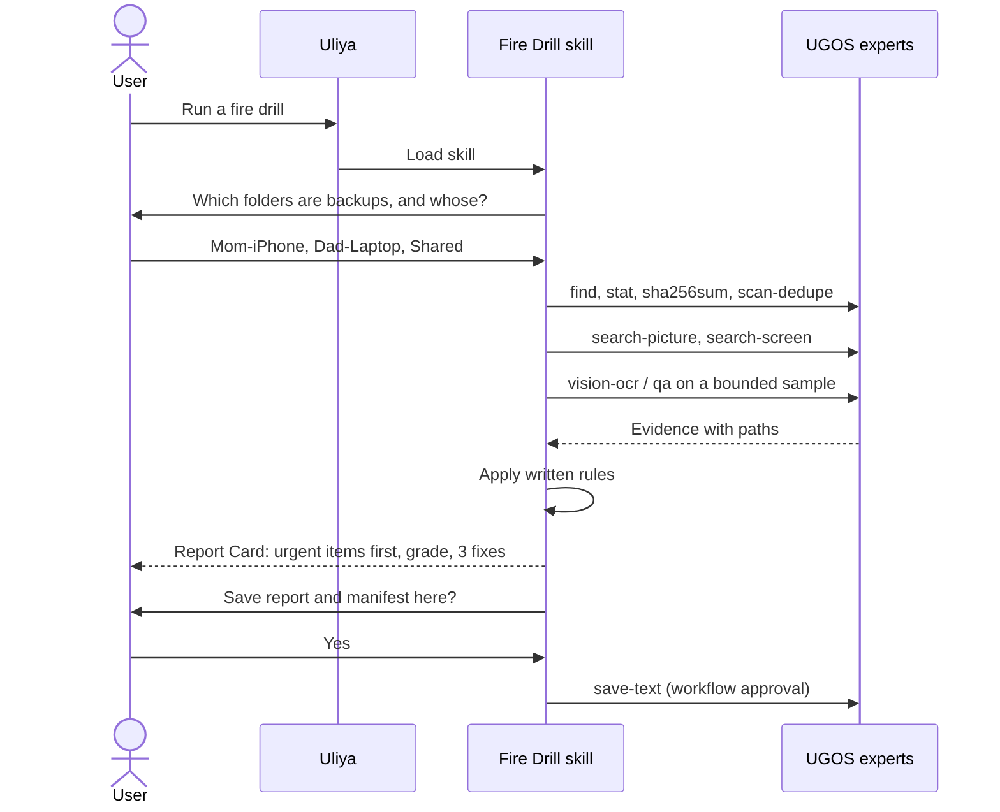
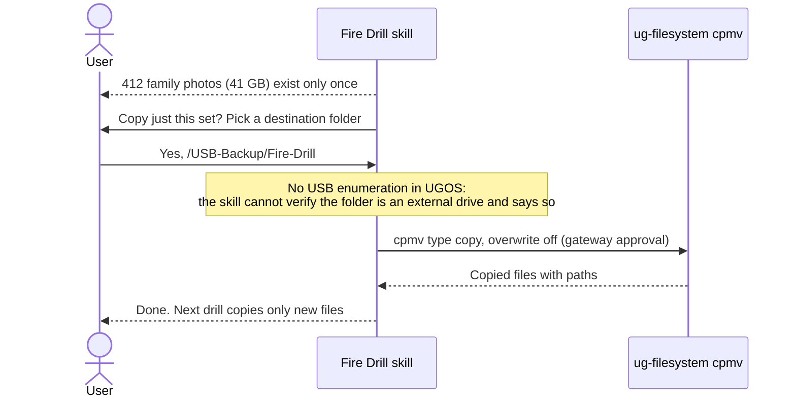
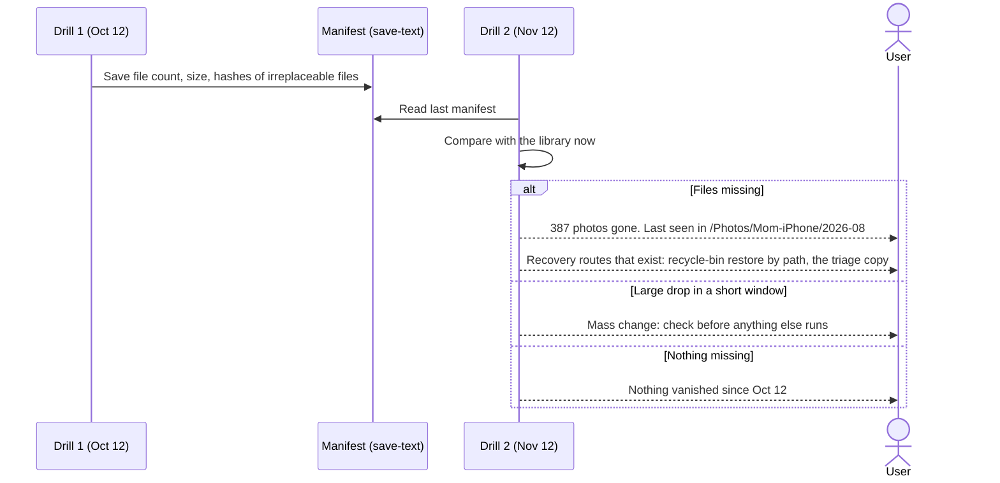

# Fire Drill diagrams

How Fire Drill runs on a UGREEN AI NAS, drawn from the skill package (`skill/backup-fire-drill/`) and the capability findings in `docs/design.md`. GitHub renders every diagram below.

1. [What Fire Drill can touch](#1-what-fire-drill-can-touch)
2. [Drill pipeline](#2-drill-pipeline)
3. [How evidence becomes a finding](#3-how-evidence-becomes-a-finding)
4. [Silent-stop rule](#4-silent-stop-rule)
5. [Sequence: a drill from the chat](#5-sequence-a-drill-from-the-chat)
6. [Sequence: the triage copy](#6-sequence-the-triage-copy)
7. [Vanish check across two drills](#7-vanish-check-across-two-drills)
8. [UGOS capability map](#8-ugos-capability-map)

## 1. What Fire Drill can touch

Everything stays on the NAS. Fire Drill reads through UGOS experts, and writes only two things, each after the user confirms: the triage copy and the saved report with its manifest.

## 2. Drill pipeline

## 3. How evidence becomes a finding

The on-device AI only opens and classifies files. Every flag and grade comes from the written rules in `references/`, and every finding carries a receipt.

## 4. Silent-stop rule

A folder that only gets occasional files must not be flagged, so the rule compares the gap against the folder's own rhythm.

## 5. Sequence: a drill from the chat

## 6. Sequence: the triage copy

## 7. Vanish check across two drills

## 8. UGOS capability map

From the kit capability catalog (version 2.0.0). Line numbers point at `data/capability-catalog.json` in the kit.

| Fire Drill step | UGOS capability | Catalog line | Approval |
|---|---|---|---|
| Find files, dates | ug-filesystem find, stat | 1603, 1871 | none (read) |
| Hashes | ug-filesystem sha256sum | 1840 | none (read) |
| Duplicates | ug-filemgr scan-dedupe | 2396 | none (read) |
| People and events | ug-photo search-picture | 4235 | none (read) |
| Screenshots | ug-photo search-screen | 4494 | none (read) |
| Open test, photos | ug-photo vision-ocr, vision-vlm | 4917, 4948 | none (read) |
| Capture date | ug-photo meta | 4879 | none (read) |
| Open test, documents | ug-document qa, extract | 3202, 3331 | none (read) |
| Triage copy | ug-filesystem cpmv (type copy) | 1949 | gateway |
| Save report + manifest | ug-knowledge save-text | 3836 | workflow |
| Restore a vanished file | ug-filesystem restore | 2191 | gateway |
| Not available | USB listing, snapshots, recycle-bin listing, scheduler | not found | worked around, see `docs/design.md` |
