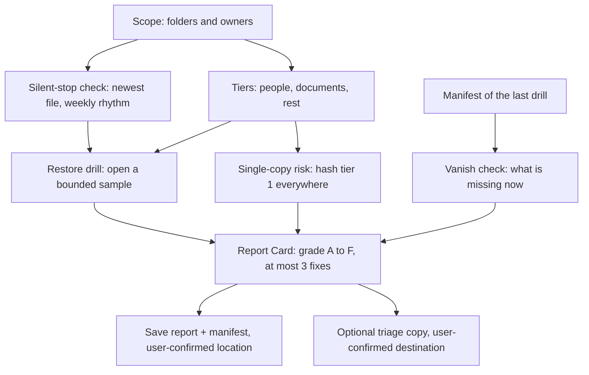

# Design notes

Fire Drill is a restore drill the NAS runs when the user asks, with a "next drill due" reminder on every Report Card, ranked by what you could never get back. It checks the folders people actually use as backups, not backup jobs it cannot see. Every finding carries a receipt: the file path, the expert that opened it, and the outcome.

## Pipeline

The rules decide; the experts only gather evidence. The grade comes from the rubric in the skill references, never from a judgment call in the moment.

## Capability findings

Checked against the kit capability catalog (version 2.0.0, dated 2026-09-01) before anything was designed. Receipts point at `data/capability-catalog.json` in the kit.

| Capability | Verdict | Evidence in the kit catalog |
|---|---|---|
| File find | Found | `ug-filesystem` `find`, line 1603: path, pattern, type, size and date filters, read effect, no approval. |
| File stat / mtime | Found | `ug-filesystem` `stat`, line 1871: size and times; `find` date filters at lines 1660 to 1679. |
| Hash | Found | `ug-filesystem` `md5sum` line 1809, `sha256sum` line 1840, both read, no approval. |
| Dedupe | Found | `ug-filemgr` `scan-dedupe` line 2396: repeatable paths, scope images or documents or all, read, no approval. |
| Copy to another folder | Found | `ug-filesystem` `cpmv` line 1949 with `type` = copy at lines 1967 to 1976; state-change with gateway approval at lines 1992 to 1993. |
| Copy to a USB or external volume | Not found | No action lists volumes or external drives. Named volumes appear only as a `share-mkdir` parameter, line 2226 (example "volume1" at line 2287). The copy destination must be an existing folder path the user picks. |
| Person / face search | Found | `ug-photo` `search-picture` line 4235 with `figure-uuid` / `figure-name` / `pet-uuid` / `pet-name` parameters at lines 4260 to 4286; face albums via `albums` `album-type` at line 3930; per-person timeline at line 5560. |
| Screenshot split | Found | `ug-photo` `search-screen` line 4494, `category` = screen in the enum at lines 4502 to 4517. |
| Photo open / vision / OCR | Found | `ug-photo` `vision-ocr` line 4917 and `vision-vlm` line 4948 (prompt plus path), both read, no approval; EXIF via `meta` line 4879. |
| Document read | Found | `ug-document` `qa` line 3202 (intent content_read), `extract` line 3331, `metadata` line 3154, `page-count` line 3123, all read, no approval. |
| Saving a text file | Found | `ug-knowledge` `save-text` line 3836: state-change, workflow approval at lines 3868 to 3869, returns verified output file at line 3870. `ug-filesystem` `echo` line 2043 and `touch` line 2303 also write text, with gateway approval. |
| Recycle bin access | Partial | `ug-filesystem` `restore` line 2191 restores from a recycle path (example at line 2206). No action lists recycle-bin contents: not found. |
| Snapshot access | Not found | The only "snapshot" in the kit is the surveillance evidence type at lines 1212 to 1214, unrelated to storage snapshots. |
| Scheduled or automatic skill runs | Not found | No scheduling, timer, cron or trigger capability exists in the kit. The drill runs when the user asks, and every Report Card ends with "next drill due" plus a date. |

Design consequences:

- The vanish check saves its manifest as text through `save-text` (confirmed capability) and names recovery routes only when they exist: recycle-bin restore, or the triage copy.
- The triage copy uses `cpmv` with type copy after the user confirms the set and the destination. Because no USB volume enumeration exists, the destination is an existing folder path; if the user names an external drive the skill cannot verify it and says so.
- Recurrence relies on the user plus the "next drill due" line, and the skill also answers everyday asks so the footer stays visible.

## Decisions

| Date | Decision | Why |
|---|---|---|
| 2026-11-11 | Report order: vanished, single-copy, silent-stop, broken, grade and fixes. | Spec section 12 is later than section 4 and wins where they differ. |
| 2026-11-11 | Silent-stop rule uses both newest-file age and the folder's own median arrival gap: flag when gap >= max(3 x rhythm, 14 days). | Spec section 10 rule 7: a folder that only gets occasional files must not be falsely flagged. |
| 2026-11-11 | Screenshot tier uses the screen category search instead of name patterns. | Confirmed read capability; keeps screenshots out of tier 1 no matter what they are named. |
| 2026-11-11 | Manifest and report saved through `save-text` after the user confirms the location. | Confirmed capability with workflow approval; no snapshot capability exists to lean on. |
| 2026-11-11 | Triage copy through `cpmv` type copy, overwrite off, confirmed destination. | Confirmed capability with gateway approval; USB enumeration not found, so no USB claim is made. |
| 2026-11-11 | No scheduler: drill on ask, "next drill due" line on every card. | Scheduling marked not found in the kit; spec section 11.3 fallback. |
| 2026-11-11 | Pre-commit guard also blocks GLM_HANDBOOK.md and any file name ending in SPEC.md or SETUP.md, beyond the standard setup list. | Owner instruction for this repository. |
| 2026-11-11 | Hook files were committed while the hooks were not yet active, then core.hooksPath was enabled locally. | The hook's own secret-scan patterns would otherwise match their own diff; the scan itself is unchanged. |
| 2026-11-11 | CI fetches the official kit zip (0.7.3-en) from the starter-kit page at a pinned URL instead of committing the kit. | The kit must not be redistributed; the pinned download was verified byte-identical to the local copy. |
| 2026-11-12 | The README states the Open Innovation track; the owner draft said "Explore Your Imagination". | The Devpost page lists four tracks and Open Innovation is one of them; no track by the draft's name exists (checked Nov 12, 2026). |
| 2026-11-12 | Source links added for the Macrium 2017 survey and the Feb 7, 2026 photo-deletion incident. | Both verified: Macrium blog, March 9, 2017 (46% have never completed a test restore); Futurism report, Feb 13, 2026, on the Feb 7 desktop-tidying deletion of about 15,000 family photos. |
| 2026-11-12 | Silent-stop rule refined: rhythm is the median gap among the arrivals preceding the newest file; fewer than 3 gaps means "insufficient evidence" and no flag; the rule runs on device-backup folders only (scope mapping), not archives. | The earlier 12-week window missed stops longer than the window (a 90-day gap left nothing to measure) and guessed at folders too small to have a rhythm; the owner diagram in docs/DIAGRAMS.md section 4 already shows the insufficient-history branch. |
| 2026-11-12 | Single-copy counts device originals, as recorded in the scope mapping, plus matches in other scoped folders. | Counting scoped folders alone flags every one-folder case: a phone backup whose originals are on the phone would grade D, and the spec's section 10 pack requires healthy folders to go unflagged. |
| 2026-11-12 | When a ransomware tell fires, failed open tests report under the warning instead of as broken uploads. | Renamed files fail the open test; without the rule the three ransom cases would also carry the broken-file flag their expected results forbid. |
| 2026-11-12 | The open-fail spike tell requires at least 100 files in the folder. | On smaller folders the 25 percent rate is noise: one failed file out of three would fire the tell. |
| 2026-11-12 | Drill Pack fixtures upgraded to generator-grade: scope (role, device, originals), coherent history blocks, and burst blocks replace the Night 1 narrative numbers. | The narrative numbers did not cohere (six weeks of about 40 files a week cannot end 74 days ago inside a 12-week window); the simulator needs exact, self-consistent inputs. |
| 2026-11-12 | Identical synthetic content is declared with an explicit contentId per file. | Hashing path and size made cross-folder duplicate detection impossible; contentId models what the expert hash result means. |
| 2026-11-12 | EXIF capture dates for the silent-stop rule are deferred to finalist day and stay on the README roadmap. | The rule needs real NAS metadata to be worth anything; the kit catalog confirms the `meta` action exists (line 4879), but designing against invented EXIF behaviour would violate the no-invention rule. |
| 2026-11-12 | The submission ZIP is built by scripts/build-package-zip.mjs from skill/backup-fire-drill/ only, and CI re-checks the unzipped copy with the kit checker. | `tools/` is reserved for excluded local tooling, so the script lives under scripts/; a build artifact must never enter the package. |

## Known gaps

- The simulator models the UGOS expert outputs from the fixture declarations: a file's declared state decides its open-test verdict and its kind decides its tier. On a NAS those verdicts come from the vision, OCR and document actions, which the simulator does not call.
- The bench ran on the simulator, on a laptop. Nothing has run on a NAS; the static checker proves the package shape, not device behaviour.
- Sample-based by design: pass rates describe the opened sample; the report always says so.
- No recycle-bin listing and no snapshot access in the kit, so vanished files can be pointed at recovery routes only when they exist.
- No scheduler in the kit, so recurrence depends on the user and the "next drill due" line.
- Rhythm rules use modification times as a proxy for arrival dates; capture dates from photo EXIF are not used yet (the `meta` action exists and is a candidate).
- Ransomware tells are warnings, not detection guarantees.
