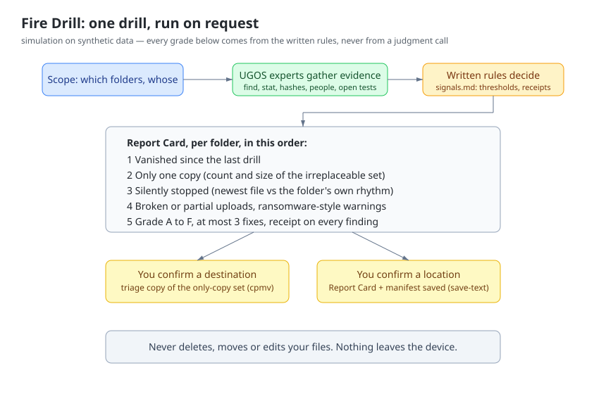
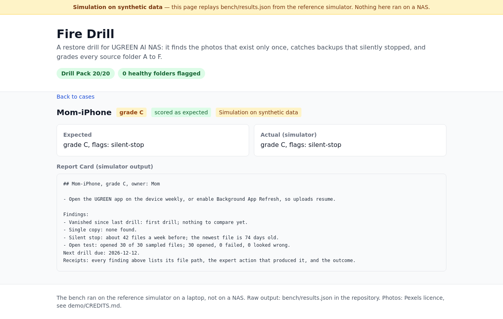

# Fire Drill

**UGREEN Hackathon 2026 on AI NAS, Open Innovation track**

Fire Drill tests whether your NAS could really bring back what matters. It opens a sample of your files with the NAS's on-device AI, catches silently stopped backups, spots files that no longer open, counts irreplaceable photos with only one copy, and grades every source folder A to F in one Report Card.

## The problem

A NAS is bought so nothing gets lost, yet almost nobody tests it: 46% of backup users have never completed a test restore (Macrium survey, 2017). Phone uploads stop when the app sits in the background and nobody notices. People then delete photos from their phones, so for many family pictures the NAS is the only copy; one failed pool, theft or ransomware ends them. The newest deleter is software: on Feb 7, 2026 an agent asked to tidy a desktop deleted 15,000 family photos. A second copy is the only safety net, and nobody knows which files lack one.

## What Fire Drill does

1. Scopes the folders you use as backups and whose they are.
2. Ranks what matters: people photos tier 1, documents tier 2, the rest tier 3.
3. Opens a bounded sample per tier (30/20/10, oldest first) with the on-device vision, OCR and document experts.
4. Sizes the set of tier-1 photos with one folder copy and offers to copy it where you confirm.
5. Reads the arrival rhythm: catches stopped backups without flagging occasional or archive folders.
6. Compares with the last drill's manifest: names what vanished and where recovery routes exist.
7. Grades A to F by a written rubric, with at most three fixes in plain words and a receipt on every finding.

Read-only except the copy and the saved report, each behind your confirmation. A folder it cannot read reports "could not check", never a grade.

## Why this wins

Backup tools check job status and hashes; neither proves a photo still opens, nor knows your daughter's pictures from screenshots. The UGOS experts do, on the device. The Markdown-only package passes the official kit checker with zero errors, warnings and notes; every capability is confirmed in the kit catalog with line numbers. Written rules decide every grade; the experts only gather evidence.

A 20-case Drill Pack with four healthy controls scores 20/20 on the reference simulator — a laptop, not a NAS. An adversarial holdout then stress-tested the rules: 1/6 before fixes, 6/6 after; a second holdout scores 2/4, with both gaps named. Rules, simulator and results are public.

## Known gaps

The check samples, not a full scan; ransomware signs are warnings, not guarantees. UGOS exposes no USB listing, snapshots or scheduler, so the drill runs on request with a reminder, the copy targets a folder you pick, and vanished files point to recovery routes that exist.

## Finalist day

Run the Drill Pack on an iDX6011 Pro and publish the measured score next to the simulator's 20/20.
